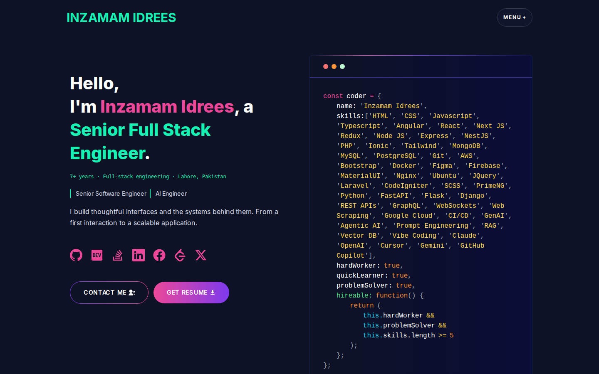

<p align="center" width="100%">
    
</p>

---

# Software Developer Portfolio

A multi-theme portfolio platform for a senior full-stack engineer. One validated content source (`portfolio-data/`) is rendered by seven distinct themes, with a private admin area for content editing, theme preview and theme activation. Built with Next.js 15 (App Router), React 19, Tailwind 3 and Sass. No database.

## Demo



<!-- ACTIVE-THEME:START -->
Active theme: **Sienna**. Dark-first personal portfolio in raw sienna: portrait over a paint splash, stat cards, skill tiles and a masonry works grid, with a light mode.
<!-- ACTIVE-THEME:END -->

[View the live site](https://inzamam-idrees.netlify.app/)

## Features

- **Seven themes** over the same content, each with its own purpose:
  **Coding** (code-inspired), **Cinematic** (editorial, optional 3D), **Executive** (recruiter-first), **Spatial** (interactive system model), **Prism** (portrait-led glass panels), **Creative** (light, illustrated) and **Sienna** (dark-first, paint splash). Every theme renders the same sections: roles, skills, experience, projects (with `/project/<slug>` pages), education, awards, certificates, résumé preview, writing and contact.
- **Validated content:** every document in `portfolio-data/` is checked against strict Zod schemas; invalid content fails the build. All visible wording is data too.
- **Admin:** password-protected `/admin` for editing every document, previewing any theme at `/preview/<theme>` and activating one. Previews never affect the public site.
- **Static public routes:** `/`, `/project`, `/project/<slug>` are prerendered and `/blog` revalidates hourly. Per-route metadata, JSON-LD, `/llms.txt`, sitemap and robots are generated from canonical content.

## Tech stack

- Next.js 15, React 19, plain JavaScript (no TypeScript)
- Tailwind CSS 3 and Sass; per-theme stylesheets compiled by `scripts/build-theme-css.mjs`
- Zod 4 for content and copy schemas
- Three.js with `@react-three/fiber` (Cinematic and Spatial only) and GSAP (Cinematic)
- nodemailer and reCAPTCHA for the contact form
- Node's built-in test runner; ESLint through `next lint`

Dependency decisions: [`docs/portfolio/dependency-decisions.md`](docs/portfolio/dependency-decisions.md).

## Quick start

Prerequisites: Node 22 (`.nvmrc`; `>=20.9` is supported) and npm.

```bash
npm install
cp .env.example .env     # then fill in what you need
npm run dev              # http://localhost:3000
```

| Command | Purpose |
|---|---|
| `npm run build` | Validate content, compile theme CSS, build |
| `npm run start` | Serve the production build |
| `npm run validate:content` | Validate `portfolio-data/` only |
| `npm run test:unit` | Unit tests |
| `npm run lint` | ESLint |
| `npm run admin:password` | Private local admin password reset |
| `npm run capture:screenshots` | Regenerate per-theme screenshots (needs a running server) |
| `npm run sync:readme` | Copy the active theme's screenshot to `public/image/screen.png` and update this README |

## Configuration

Copy `.env.example` to `.env`. Secrets must never use the `NEXT_PUBLIC_` prefix.

| Variable | Purpose |
|---|---|
| `EMAIL_ADDRESS`, `GMAIL_PASSKEY` | Contact form delivery through Gmail (app password) |
| `RECAPTCHA_SECRET_KEY` | Server-only reCAPTCHA verification |
| `NEXT_PUBLIC_GTM` | Optional Google Tag Manager ID (`GTM-...`) |
| `SITE_URL` | Verified public HTTPS origin; enables canonical URLs and sitemap |
| `PORTFOLIO_ADMIN_PASSWORD_HASH`, `PORTFOLIO_ADMIN_SESSION_SECRET` | Admin sign-in (session secret of 32+ characters) |
| `PORTFOLIO_CONTENT_STORE` | `filesystem`, `github` or `readonly` |
| `GITHUB_CONTENT_TOKEN`, `GITHUB_CONTENT_REPO`, `GITHUB_CONTENT_BRANCH` | GitHub content store |
| `PORTFOLIO_DATA_DIR` | Optional alternative data root (persistent-volume hosts only) |

`NEXT_PUBLIC_APP_URL` and `TELEGRAM_*` remain in `.env.example` from the original template; no code reads them. Escape `$` as `\$` in the admin password hash.

## Content and admin

All content is JSON under `portfolio-data/`. Read [`docs/multi-theme/phase-2-canonical-content.md`](docs/multi-theme/phase-2-canonical-content.md) before editing it by hand; themes never contain factual content.

Signed-in administrators edit documents at `/admin/content`. Forms are generated from the same schemas the build uses, every save is validated, and concurrent edits are rejected as conflicts. Saves go through the store chosen by `PORTFOLIO_CONTENT_STORE`:

| Store | Where a save goes |
|---|---|
| `filesystem` | Local default: writes `portfolio-data/` immediately |
| `github` | Commits the JSON to `GITHUB_CONTENT_BRANCH`; the host redeploys |
| `readonly` | Production default: editing and activation disabled |

Writing posts come from dev.to (set `provider.username` in `portfolio-data/content/articles.json`). More: [theme architecture](docs/multi-theme/phase-3-theme-architecture.md), [preview and activation](docs/multi-theme/phase-5-preview-activation-hosting.md), [content parity across themes](docs/multi-theme/phase-12-content-parity-result.md), [SEO audit](docs/seo/2026-10-19-seo-audit.md), [setup and recovery notes](docs/portfolio/operations.md).

## Deployment

Deployed on Netlify (`netlify.toml`, Node 22). Content is validated and bundled at build time, and the default is read-only. For production editing, set `PORTFOLIO_CONTENT_STORE=github` plus the `GITHUB_CONTENT_*` variables so admin saves commit to the repository and Netlify redeploys; this has only been tested against a mocked GitHub API. Persistence assessment: [`docs/multi-theme/phase-6-netlify-persistence-readiness.md`](docs/multi-theme/phase-6-netlify-persistence-readiness.md). Environment and GitHub-token setup: [`docs/portfolio/operations.md`](docs/portfolio/operations.md).

## License

MIT. See [`LICENSE.txt`](LICENSE.txt).
