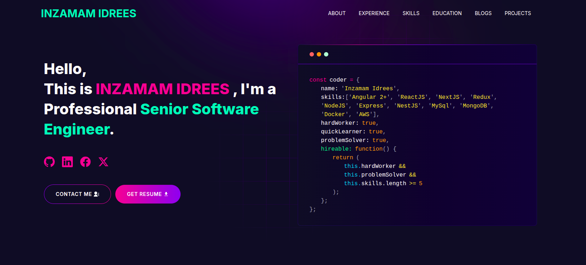

<p align="center" width="100%">
    
</p>

---

<!-- # [Built Portfolio With GitHub ](https://github.com/inzamam-idrees/github-portfolio) -->

<!-- --- -->

# Software Developer Portfolio

#### Are you having trouble making a website for your portfolio that looks good? Look no further!  You can use the Software Developer Portfolio template and create your very own personalized portfolio today!  My website is designed to be user-friendly and easily customizable, making it perfect for both developers and freelancers.

---

# Demo :movie_camera:



## View live preview [here](https://inzamam-idrees.netlify.app/).

---

## Table of Contents :scroll:

- [Sections](#sections-bookmark)
- [Demo](#demo-movie_camera)
- [Installation](#installation-arrow_down)
- [Getting Started](#getting-started-dart)
- [Usage](#usage-joystick)
- [Deployment](#deployment-rocket)
- [Tutorials](#tutorials-wrench)
  - [Gmail App Password Setup](#gmail-app-password-setup)
  - [Create a Telegram Bot](#create-a-telegram-bot)
  - [Fetching Blog from dev.to](#fetching-blog-from-devto)
- [Packages Used](#packages-used-package)

---

# Sections :bookmark:

- HERO SECTION
- ABOUT ME
- EXPERIENCE
- SKILLS
- PROJECTS
- EDUCATION
- BLOG
- CONTACTS

---

# Installation :arrow_down:

### You will need to download Git and Node to run this project

- [Git](https://git-scm.com/downloads)
- [Node](https://nodejs.org/en/download/)

#### Make sure you have the latest version of both Git and Node on your computer.

```bash
node --version
git --version
```

## <br />

# Getting Started :dart:

### Fork and Clone the repo

To Fork the repo click on the fork button at the top right of the page. Once the repo is forked open your terminal and perform the following commands

```bash
git clone https://github.com/<YOUR GITHUB USERNAME>/software-developer-portfolio.git

cd software-developer-portfolio
```

### Install packages from the root directory

```bash
npm install
# or
yarn install
```

Then, run the development server:

```bash
npm run dev
# or
yarn dev
```

Open [http://localhost:3000](http://localhost:3000) with your browser to see the result.

---

### Running with Docker Compose

1. **Build Docker Image and Run Container**:
    ```bash
    docker-compose up --build
    ```

2. **Access the Application**:
    Visit [http://localhost:3000](http://localhost:3000) in your web browser to view the running application.

---

### Building the Docker Image

1. **Build the Docker Image using Dockerfile.dev**:

    ```bash
    docker build -t nextjs-app -f Dockerfile.dev .
    ```

2. **Running the Docker Container**:

    ```bash
    docker run -p 3000:3000 nextjs-app
    ```

3. **Access the Application**:
    Visit [http://localhost:3000](http://localhost:3000) in your web browser to view the running application.

---

# Usage :joystick:

Please create a new `.env` file from `.env.example` file.

Eg:

```env
NEXT_PUBLIC_GTM =
NEXT_PUBLIC_APP_URL =
TELEGRAM_BOT_TOKEN =
TELEGRAM_CHAT_ID =
GMAIL_PASSKEY =
EMAIL_ADDRESS =
```

Portfolio content is stored in validated JSON under `portfolio-data/`. See
[`docs/multi-theme/phase-2-canonical-content.md`](docs/multi-theme/phase-2-canonical-content.md)
before editing it. The multi-theme registry, contract, and loading boundaries are
documented in
[`docs/multi-theme/phase-3-theme-architecture.md`](docs/multi-theme/phase-3-theme-architecture.md).
Themes receive canonical content through the validated loader; do not create editable
professional-content copies inside a theme.

Private theme preview is documented in
[`docs/multi-theme/phase-5-preview-activation-hosting.md`](docs/multi-theme/phase-5-preview-activation-hosting.md).
It requires `PORTFOLIO_ADMIN_PASSWORD_HASH` and
`PORTFOLIO_ADMIN_SESSION_SECRET`. Preview is cookie-scoped and does not modify the
public active setting.

### Admin content editing

Signed-in administrators can edit every portfolio document, including theme copy and
the active theme, at `/admin/content`. Forms are generated from the same Zod schemas
the build uses. Every save is validated on the server, both the document alone and
the whole portfolio together, before it is stored. Two tabs editing the same document
cannot overwrite each other: the second save is rejected as a conflict.

Saves go through the store selected by `PORTFOLIO_CONTENT_STORE`:

| Store | Use | Where a save goes |
|---|---|---|
| `filesystem` | Local development (default outside production) | Writes `portfolio-data/` (or `PORTFOLIO_DATA_DIR`) and is live immediately. |
| `github` | Production on Netlify | Commits the JSON file to `GITHUB_CONTENT_BRANCH`; Netlify redeploys and the change is live in about 1–2 minutes. Git history is the revision log and backup. |
| `readonly` | Production default | Editing and activation are disabled. |

To enable GitHub storage, create a **fine-grained personal access token** limited to
this repository with **Contents: Read and write** permission only, then set
`PORTFOLIO_CONTENT_STORE=github`, `GITHUB_CONTENT_TOKEN`, `GITHUB_CONTENT_REPO`
(`owner/name`) and `GITHUB_CONTENT_BRANCH` (the branch Netlify deploys) in the host's
environment settings. Never prefix them with `NEXT_PUBLIC_`.

---

# Deployment :rocket:

Deploying the app to platforms like Vercel or Netlify is quick and easy.

Content is bundled at build time. Runtime edits from the admin are persisted by
committing to GitHub (see Admin content editing), never by writing the host's
ephemeral filesystem. A host with a persistent volume can instead use
`PORTFOLIO_CONTENT_STORE=filesystem` with `PORTFOLIO_DATA_DIR`.

## Deploying to Vercel:

1. **Sign up or log in** to [Vercel](https://vercel.com/).
2. Once logged in, click on **"New Project"**.
3. Select your **GitHub repo** (the one that contains your forked project) and click **Import**.
4. Configure your environment variables in the Vercel dashboard by adding each key from your `.env` file.
   - E.g., `NEXT_PUBLIC_GTM`, `NEXT_PUBLIC_APP_URL`, `TELEGRAM_BOT_TOKEN`, etc.
5. Click on **Deploy**. Vercel will automatically detect your Next.js app and build it.
6. Once the deployment is complete, you can visit your live website!

### Updating After Deployment

Whenever you push changes to your GitHub repo, Vercel will automatically redeploy the app, keeping your portfolio up-to-date.

## Deploying to Netlify:

Canonical JSON is validated and bundled into the server function, and content changes
are published through a new deploy. With GitHub content storage configured, admin
edits and theme activation commit to the repository and Netlify's continuous
deployment publishes them; without it the deployment is read-only. See
[`docs/multi-theme/phase-6-netlify-persistence-readiness.md`](docs/multi-theme/phase-6-netlify-persistence-readiness.md)
for the persistence assessment and future migration path.

1. **Sign up or log in** to [Netlify](https://www.netlify.com/).
2. In the **Netlify Dashboard**, click **"New site from Git"**.
3. Connect your **GitHub** account and select your repo.
4. Configure runtime values in Netlify environment settings. Set `SITE_URL`,
   `PORTFOLIO_ADMIN_PASSWORD_HASH`, and `PORTFOLIO_ADMIN_SESSION_SECRET` for both Builds
   and Functions where scopes are available. Never use `NEXT_PUBLIC_` for secrets.
   Leave `PORTFOLIO_DATA_DIR` unset. To enable admin editing, also set
   `PORTFOLIO_CONTENT_STORE=github`, `GITHUB_CONTENT_TOKEN`, `GITHUB_CONTENT_REPO`
   and `GITHUB_CONTENT_BRANCH` (Functions scope is enough). If sign-in then reports
   that administrator access is unavailable, escape every `$` in
   `PORTFOLIO_ADMIN_PASSWORD_HASH` as `\$`: in local testing Next.js expanded `$` in
   this value even when it was set as a process environment variable. This has not
   been verified on Netlify.
5. Click **Deploy Site**. Netlify will build and deploy your portfolio.

---

# Tutorials :wrench:

## Gmail App Password Setup

1. **Log in to your Google Account** at [https://myaccount.google.com/](https://myaccount.google.com/).
2. Navigate to **Security** from the left sidebar.
3. Scroll down to the **"Signing in to Google"** section and make sure **2-Step Verification** is turned ON.
4. Once 2-Step Verification is enabled, you'll see an option for **App Passwords**.
5. Click on **App Passwords**. You may need to enter your Google account password again.
6. In the **Select app** dropdown, choose "Mail", and for **Select device**, choose "Other (Custom name)" and name it appropriately (e.g., "Portfolio").
7. Click **Generate**. A 16-character app password will be displayed. Save this password for later use in your environment variables (e.g., `GMAIL_PASSKEY`).

## Create a Telegram Bot

1. **Open Telegram** and search for the user **@BotFather**.
2. Start a chat with BotFather and use the `/newbot` command to create a new bot.
3. Choose a name for your bot.
4. Set a unique username for your bot (must end with `bot`, e.g., `PortfolioAssistantBot`).
5. Once your bot is created, BotFather will send you a **Token**. Save this token, as you will need it for your environment variables (e.g., `TELEGRAM_BOT_TOKEN`).
6. To get your chat ID:
   - Open your bot in Telegram and send it a message.
   - Visit the following URL in your browser, replacing `BOT_TOKEN` with your actual bot token:  
     `https://api.telegram.org/bot<BOT_TOKEN>/getUpdates`
   - Look for the `chat` object in the response, which contains your **chat ID** (you can use this value for `TELEGRAM_CHAT_ID`).

## Fetching Blog from dev.to

To display your blog posts from dev.to on the portfolio:

1. Set `provider.username` in `portfolio-data/content/articles.json` to your dev.to username.
2. The application will automatically fetch your latest blog posts and display them in the **BLOG** section.
3. Ensure your blogs are publicly visible on dev.to, and the application will fetch them using the dev.to API.

---

# Packages Used :package:

|   Used Package List    |
| :--------------------: |
|    @emailjs/browser    |
|  @next/third-parties   |
|         axios          |
|      lottie-react      |
|          next          |
|       nodemailer       |
|         react          |
|       react-dom        |
|   react-fast-marquee   |
| react-google-recaptcha |
|      react-icons       |
|     react-toastify     |
|         sharp          |
|          sass          |
|      tailwindcss       |

---

# FAQ:

1. For those facing the issue of "`next` is not recognized as an internal or external command, operable program or batch file."

Run the following command:

```bash

npm install -g next

```

This installs Next.js globally

then do the usual `npm run dev`


## Cinematic portfolio implementation

Requires Node.js 20.9 or newer (validated with Node 22).

The existing Next.js App Router application reads all factual content through the
server-only validated loader in `lib/portfolio`. The bundled development data lives
in `portfolio-data`; set `PORTFOLIO_DATA_DIR` to an absolute alternative data root
when a deployment should read the same structure from a persistent volume.
Server-rendered chapters remain readable without JavaScript or WebGL. One lazy Fiber
canvas uses Three.js; GSAP owns scroll progression. Native scrolling is the baseline.
No Drei, Lenis or post-processing is installed. The motion control respects the system
reduced-motion preference and persists an explicit pause choice.

Set `SITE_URL` only to the verified public HTTPS origin, without a path or credentials.
When absent, canonical links, Person URL and sitemap references are omitted. The local
social image needs no external assets. Contact delivery uses the existing
`EMAIL_ADDRESS` and `GMAIL_PASSKEY`; never commit credentials. Test delivery is mocked.

## Spatial theme

Spatial presents the same canonical content as an explorable system model: the skills
graph, the featured projects and the career history are built from the data, never
written into the theme. Every section is server-rendered and complete without
JavaScript or WebGL. After the page has loaded, one lazy React Three Fiber canvas
draws the hero model, the skills graph, a project ring and an experience spine into
reserved panels. It uses a reduced static mode for reduced motion, a paused motion
preference (shared with Cinematic) or software rendering, and no 3D at all without
WebGL2 or with `features.threeD` off. Spatial adds no dependencies and loads no GSAP.
Details: `docs/multi-theme/phase-8-spatial-result.md`.

Run `npm run test:unit`, `npm run lint`, and `npm run build` for local checks.
Browser cases in `tests/browser` run with the installed Playwright CLI, e.g.
`playwright-cli -s=portfolio run-code --filename=tests/browser/navigation.js`.
If another Next process uses the checkout, isolate generated files:
`PORTFOLIO_BUILD_DIR=.next-portfolio-dev npm run dev -- --port 3001`.
Use the same `PORTFOLIO_BUILD_DIR` for a production build and its start command.
Validation evidence and dependency choices are recorded under `docs/portfolio`.
